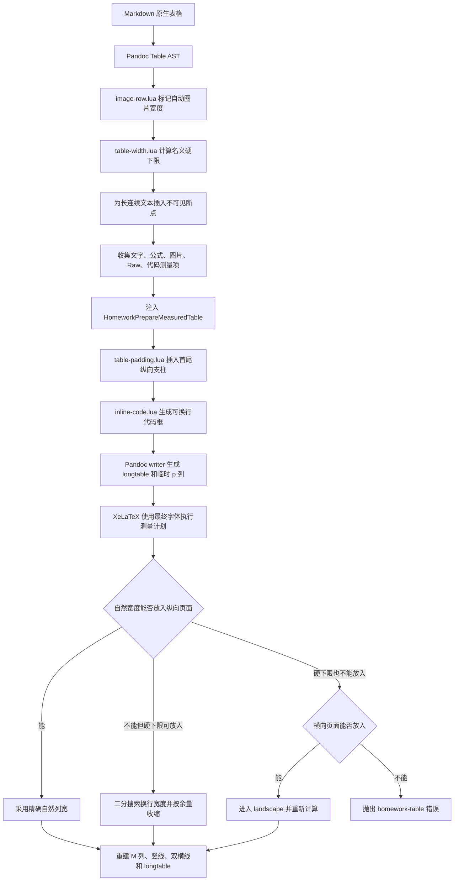

# Pandoc 工科作业模板开发文档

本文档面向模板维护者，记录实现逻辑、模块边界、关键数据流和已知限制。当前首先覆盖表格系统；后续可以继续增加标题、代码、图片、引用块、自动转换等章节。

> 当前实现基线：Pandoc 3.11、XeLaTeX、`templates/homework.tex`。  
> 最后核对日期：2026-10-27。

## 1. 文档约定与代码入口

表格逻辑分布在以下文件中：

| 文件 | 职责 |
|---|---|
| [`defaults/homework.yaml`](./defaults/homework.yaml) | 确定转换格式、XeLaTeX 引擎、模板、元数据文件和过滤器顺序 |
| [`metadata/homework.yaml`](./metadata/homework.yaml) | 保存表格宽度、边线、内边距、横向页面等默认参数 |
| [`filters/image-row.lua`](./filters/image-row.lua) | 在宽度分析前标记无显式宽度的图片 |
| [`filters/table-width.lua`](./filters/table-width.lua) | 分析 Pandoc `Table` AST、添加断点、生成测量计划、包装不可断内容 |
| [`filters/table-padding.lua`](./filters/table-padding.lua) | 将纵向留白支柱插入每个单元格真正的首行和末行 |
| [`filters/inline-code.lua`](./filters/inline-code.lua) | 将最终行内代码转换成可分段、可换行的 LaTeX 代码框 |
| [`templates/homework.tex`](./templates/homework.tex) | 使用最终字体实测内容、分配列宽、处理横向页面、重建 `longtable` 样式和分页标记 |
| [`test/test.md`](./test/test.md) | 人工回归样例 |

默认过滤器顺序不能随意调整：

```text
image-row.lua
    ↓ 标记自动图片宽度
table-width.lua
    ↓ 分析原始内容、注入测量计划和最终安全包装
table-padding.lua
    ↓ 在实际首尾文本行插入 3pt 纵向留白
inline-code.lua
    ↓ 将代码转换成可换行的代码框
Pandoc LaTeX writer
    ↓
homework.tex / XeLaTeX
```

这个顺序有三个直接原因：

1. `table-width.lua` 必须区分作者显式设置的图片宽度和 `image-row.lua` 添加的默认 `33%`；
2. 宽度测量不应把 `table-padding.lua` 的零宽支柱当成正文内容；
3. `table-width.lua` 需要在 `Code` 仍是 Pandoc AST 节点时收集代码宽度，随后才由 `inline-code.lua` 转换最终外观。

## 2. 从 Pandoc 原生表格开始

### 2.1 Markdown 到 Pandoc AST

最简单的管道表格：

```markdown
| 项目 | 状态 |
|:---|:---:|
| 短表 | 正常 |

: 示例题注
```

Pandoc 不会直接把它视为一段 LaTeX，而是先解析成统一的 `Table` AST。与当前实现有关的字段包括：

```text
Table
├─ attr
├─ caption
├─ colspecs[]
│  ├─ alignment
│  └─ source width / default width
├─ head.rows[].cells[]
├─ bodies[].head[].cells[]
├─ bodies[].body[].cells[]
└─ foot.rows[].cells[]
```

每个 `Cell` 还包含：

- `contents`：`Plain`、`Para`、`CodeBlock` 等块；
- `col_span`：横向跨列数；
- `row_span`：纵向跨行数；
- 单元格自身的对齐信息。

`table-width.lua` 的入口是 `Table = adjust_table_width`。它遍历表头、所有表体和表尾，不只处理第一组正文行。

### 2.2 Pandoc 原生 LaTeX 输出

没有自定义表格逻辑时，Pandoc 的 LaTeX writer 会把表格写成 `longtable`，大致结构如下：

```latex
\begin{longtable}[]{@{}ll@{}}
\caption{示例题注}\tabularnewline
\toprule\noalign{}
项目 & 状态 \\
\midrule\noalign{}
\endfirsthead
\toprule\noalign{}
项目 & 状态 \\
\midrule\noalign{}
\endhead
\bottomrule\noalign{}
\endlastfoot
短表 & 正常 \\
\end{longtable}
```

原生输出已经提供：

- 题注和表格编号；
- 首页面表头与续页表头；
- `longtable` 的跨页能力；
- 列对齐信息。

本模板没有重新实现表格 writer，而是在这套输出前后增加 Lua 测量计划，并在 LaTeX 侧改造列格式、边线和分页标记。这样可以继续利用 Pandoc 对题注、表头、表体和 AST 的原生支持。

## 3. 表格演化第一阶段：样式设计

### 3.1 竖线绘制

Pandoc 原生表格主要使用 `booktabs` 风格，不绘制完整竖线。本模板在 `homework_prepare_colspec:n` 中重建列格式：

1. 固定宽度的 `p{...}` 列改为 `M{...}`；
2. `M` 定义为 `m{...}`，使单元格内容在行内竖直居中；
3. 在每一列前插入 `|`，并在最后补一个 `|`；
4. 使用 `@{...}` 修正 `longtable` 左边界与 `hhline` 网格的参考位置。

例如概念上的：

```latex
p{20mm} p{35mm}
```

会被重建为近似：

```latex
|M{20mm}|M{35mm}|
```

竖线宽度由 `table-rule-width` 控制，默认是 `0.35pt`。

这里的列宽 `20mm`、`35mm` 只表示内容盒宽度。表格总宽度还必须加上：

- 每列左右各一个 `\tabcolsep`；
- 各条竖线的 `\arrayrulewidth`；
- 双横线和左边界对齐所需的修正量。

因此，不能把“各列内容宽度之和”等同于“表格外框宽度”。列宽分配前必须先从页面宽度中扣除这些固定开销。

### 3.2 双横线绘制

模板把 Pandoc writer 发出的三个 booktabs 命令重新定义为网格表逻辑：

| Pandoc 命令 | 当前行为 |
|---|---|
| `\toprule` | 使用 `\hhline` 绘制表头上方双横线 |
| `\midrule` | 使用 `\hhline` 绘制表头下方双横线，并把后续正文换行改为“换行后画细横线” |
| `\bottomrule` | 不额外绘制；最后一行正文已经通过统一换行逻辑画出细横线 |

双横线使用：

```latex
\hhline{|*{\LT@cols}{=|}}
```

普通正文横线使用：

```latex
\hhline{|*{\LT@cols}{-|}}
```

其中：

- `=` 表示双横线；
- `-` 表示单横线；
- `|` 负责与竖线正确相交；
- `table-header-rule-gap` 映射到 `\doublerulesep`，默认 `1.2pt`；
- `table-rule-width` 映射到 `\arrayrulewidth`。

使用 `hhline` 而不是简单连续写两个 `\hline`，是为了让横线与完整竖线网格在交点处稳定衔接。

### 3.3 内边距及其与边线的关系

水平内边距由 `table-padding-x` 控制，并写入 `\tabcolsep`。每个普通单元格会在内容盒左右各得到一个 `\tabcolsep`，因此一列对总宽度的水平内边距贡献是：

```text
2 × table-padding-x
```

纵向空间由两部分共同决定：

1. `table-row-stretch` 修改 `\arraystretch`，提供统一的基础行高；
2. `table-padding-y` 通过 `\HomeworkCellTopStrut` 和 `\HomeworkCellBottomStrut` 直接进入单元格首行、末行；表格图片的最终适配盒子还会对称扩展高度和深度。

不能只依赖 `\arraystretch` 或表格行支柱。Pandoc 会把固定宽度表头包进 `minipage`，外层数组支柱不能可靠地把多行表头的第一行推离双横线。为此，`table-padding.lua` 找到每个单元格第一个和最后一个 `Plain`/`Para`：

```text
首个文本块：插入 HomeworkCellTopStrut
末个文本块：插入 HomeworkCellBottomStrut
表格图片：HomeworkFitCellGraphic 对称扩展最终盒子的高度和深度
```

默认 `table-padding-y: 3pt`。这里的“顶部距离”从表头上方双横线的下方那条横线开始计算，而不是从上方横线开始计算。高图片会覆盖同行顶部支柱提供的高度，因此 `HomeworkFitCellGraphic` 会在缩放后的图片盒子上、下增加相同净空，并计入普通支柱深度以匹配同一行的文字单元格。普通表格和宽表格使用同一套纵向边距规则。

只有包含 `Plain` 或 `Para` 的单元格会插入这两个支柱。仅包含 `CodeBlock` 等非文本块的单元格依赖块环境自身的高度和间距；这是检查复杂块级单元格时需要单独关注的情况。

### 3.4 表格结束处的伪行保护

重定义 `longtable` 环境时，结束代码会在 TeX 仍准备读取下一行的位置执行。如果使用普通 `\multicolumn` 消耗这个状态，它会引入列格式、数组支柱或竖线，表现为第一列竖线向下多出约一行，并可能增加表后空白。

当前实现使用零高度的原始跨列操作：

```latex
\multispan{\csname LT@cols\endcsname}
```

它只结束对齐状态，不插入数组支柱和列边线，从根源上避免伪行，而不是用负间距掩盖结果。

## 4. 表格演化第二阶段：普通表格与宽表格

### 4.1 分类不是前置标签

当前实现仍可用“普通表格”和“宽表格”描述最终效果，但它们不是 Lua 阶段写入的固定类别。所有表格都会进入同一条测量路径，最终由 XeLaTeX 使用实际字体尺寸作出决定。

设：

- `W_available`：扣除水平内边距、竖线和双横线修正后的页面内容预算；
- `W_natural[i]`：第 `i` 列容纳自然内容所需的实际 TeX 宽度；
- `W_min[i]`：第 `i` 列允许收缩到的硬下限。

分类标准如下：

| 结果 | 判定 | 行为 |
|---|---|---|
| 普通表格 | `ΣW_natural ≤ W_available` | 使用自然宽度，表格随内容收缩，不铺满正文 |
| 宽表格 | `ΣW_natural > W_available`，且 `ΣW_min ≤ W_available` | 测量换行宽度，并在硬下限以上重新分配 |
| 横向表格 | 纵向页面满足不了硬下限，横向页面可以满足 | 进入 `landscape`，重新按横向预算完整计算 |
| 无法排版 | 横向页面仍满足不了硬下限 | 抛出 `homework-table` 编译错误 |

所以，“文字很多”不必然意味着最终铺满正文；如果换行后的首选宽度之和小于正文预算，宽表也会收缩到新的所需宽度。

### 4.2 `columns: 60` 的现状

`defaults/homework.yaml` 中仍保留：

```yaml
columns: 60
```

历史上，Pandoc 会使用它判断管道表格是否需要固定宽度列。当前过滤器会测量每一张表，并把列临时改成等比例 `p{...}` 占位列，所以 `columns: 60` 已不再负责筛选宽表。

它目前只承担：

- 保持 Pandoc 默认输出行为的兼容性；
- 当 `table-natural-width-columns` 没有配置时，为 Lua 名义字符预算提供回退值。

默认元数据已经配置 `table-natural-width-columns: 72`，因此正常配置下，真正的列宽分类来自 TeX 实测，而不是 `columns: 60`。

## 5. 表格的分页与题注

### 5.1 题注

Markdown 表格后的题注：

```markdown
: 基本元件参数
```

会进入 Pandoc `Table.caption`，由 writer 输出 `\caption{...}`。题注的字号、字体、标签字重、中文名称和分隔方式由以下字段控制：

- `caption-font-size`；
- `caption-font-family`；
- `caption-label-weight`；
- `caption-table-name`；
- `caption-label-separator`。

模板使用 `caption` 宏包设置这些外观，不在 Lua 中手工生成表号，因此编号仍由 LaTeX 维护。

### 5.2 跨页

所有表格使用 `longtable`。它可以在行与行之间分页，但通常不能把一个表格行拆到两页。因此，单个单元格换行过多、导致整行高度超过页面可用高度时，仍需要缩短内容或拆分表格。

Pandoc 原生输出会分别定义：

- 第一页表头；
- 后续页面重复表头；
- 非末页页脚；
- 最后一页页脚。

模板在此基础上重定义 `\endfirsthead` 和 `\endhead`：

```text
第一页末尾：正文细横线 → “（下页续）”
续页开头：“表 n（续）” → 双横线 → 重复列标题 → 双横线
最后一页：以正文细横线结束，不显示“下页续”
```

横向表格会先进入 `pdflscape` 的 `landscape` 环境，然后仍由同一个 `longtable` 机制分页。页面方向不会绕过题注和续表逻辑。

当前续表标记默认假定跨页长表具有题注。无题注长表虽然仍可分页，但续页使用的 `\thetable` 可能沿用当前计数器值；这是尚未建立专门回归样例的边界情况。

## 6. 表格整体超宽处理

这是当前表格系统的核心路径。

### 6.1 哪些情况会触发表格整体超宽

“整体超宽”指表格所有列的自然内容宽度，加上内边距和边线后，超过当前页面方向允许的正文宽度。常见触发源包括：

1. 某一列存在很长的普通句子；
2. 中文、英文、粗体、斜体组合后的实际字体宽度较大；
3. 列数很多，即使每列只有短内容，累计最小列宽和内边距仍然很大；
4. 单元格中有较宽公式或安全的行内 Raw LaTeX；
5. 图片固有宽度或作者显式宽度较大；
6. 行内代码、代码块最长行较长；
7. URL、路径、连续标识符没有普通空格断点；
8. 跨列单元格要求其覆盖列的宽度之和达到某个下限。

不能只用 Markdown 源码字符数判断这些情况。例如 `WMW` 与 `iii` 字符数相同，实际字体宽度不同；公式源码很长也不等于公式排版后一定很宽。因此，Lua 只生成结构约束，最终分类必须交给 TeX。

### 6.2 当前兼容范围

| 内容 | 当前整体宽度处理 |
|---|---|
| 普通中英文段落 | 使用最终字体测量完整自然行；超宽后试排换行高度 |
| 粗体、斜体等行内样式 | 保留样式后参与实际测量 |
| CJK 连续文字 | 利用 XeTeX 的字间自然断行能力 |
| URL、路径、长标识符 | Lua 添加不可见 `\allowbreak{}`，防止连续文本撑破页面 |
| 行内/显示公式 | 实际 TeX 宽度参与自然宽度和硬下限 |
| 图片 | 测量渲染宽度；无显式宽度图片首选值最多为内容预算的 33% |
| 行内代码 | 测量完整代码框；最终可在自然标点或字符之间拆分 |
| 代码块 | 逐行测量；最终 `Verbatim` 允许 `breaklines` 和 `breakanywhere` |
| 安全的行内 Raw LaTeX | 实际测量，使用与公式相同的有限缩放契约 |
| 结构性 Raw LaTeX | 拒绝测量并终止转换，避免在测量盒中执行结构命令 |
| 横向跨列 | 宽度约束能作用于覆盖列的总和；任意局部跨列的最终 colspec 仍需后续完善 |
| 跨行、复杂块级单元格 | 可以由 Pandoc 输出，但尚未进行完整的宽高联合测量和系统回归 |

### 6.3 完整数据流



下面按执行顺序详细说明。

#### 阶段 A：读取配置和建立名义预算

`table-width.lua` 从元数据读取：

- 纵向名义预算 `table-natural-width-columns`，默认 72；
- 横向名义预算 `table-landscape-width-columns`，默认 112；
- 每列最小可读宽度 `table-min-readable-columns`，默认 6；
- 连续文本上限 `table-unbreakable-text-columns`，默认 12。

对于 `n` 列表格，Lua 使用兼容开销估计：

```text
table_overhead(n) = 2n + (n + 1) = 3n + 1
```

前一项近似水平内边距，后一项近似竖线。于是传给 TeX 的名义内容预算是：

```text
portrait_content_budget  = 72  - (3n + 1)
landscape_content_budget = 112 - (3n + 1)
```

名义“字符列”不直接决定最终毫米宽度，只负责把 Lua 得到的最小可读权重换算成当前页面中的物理尺寸。

#### 阶段 B：建立 Lua 硬下限并添加断点

每列先取得至少 `table-min-readable-columns` 的权重。普通文本还会计算最长不可断片段：

- 空格结束一个片段；
- CJK 字符之间视为可自然断行；
- `/`、`\`、`.`、`_`、`-`、`:`、`?`、`&`、`=`、`#`、`,`、`;` 后允许自然分段；
- 最长不可断片段最多按 `table-unbreakable-text-columns` 计入硬下限。

之后，过滤器根据该下限向过长 `Str` 中插入 `\allowbreak{}`。插入发生在序列化之前，因此 TeX 的试排内容和最终单元格拥有相同断点，不会出现“测量时能换行，最终却不能换行”的偏差。

#### 阶段 C：收集物理测量项

过滤器为每个测量项记录列号和跨列数，并按内容类型生成宏：

| AST 内容 | 注入的测量宏 |
|---|---|
| `Plain` / `Para` 普通文字 | `\HomeworkMeasureTableText` |
| `Math` | `\HomeworkMeasureTableFormula` |
| `Image` | `\HomeworkMeasureTableGraphic` |
| 安全 Raw LaTeX | `\HomeworkMeasureTableRaw` |
| `Code` / `CodeBlock` | `\HomeworkMeasureTableCode` |

普通文字测量同时携带两份 LaTeX：

1. `natural_latex`：保留同行中的样式、公式、图片和代码，用 `hbox` 测量完整自然行；
2. `wrapped_latex`：保留可换行普通文字，用候选宽度试排高度；公式、图片、代码和 Raw 由各自约束单独处理。

表头目标高度默认约两行，正文和表尾默认约三行。这两个目标目前是代码常量，不是元数据字段。

#### 阶段 D：注入测量计划

过滤器把原始表格替换为三个连续块：

```text
RawBlock: \HomeworkPrepareMeasuredTable{...}
Table:    修改后的 Pandoc 表格
RawBlock: \HomeworkFinishMeasuredTable
```

`HomeworkPrepareMeasuredTable` 的数据包括：

1. 当前表格编号；
2. 纵向名义内容预算；
3. 横向名义内容预算；
4. 初始首选权重列表；
5. 初始硬下限权重列表；
6. 是否按完整外框精确扣除开销；
7. 所有内容测量命令。

当前版本中第 4、5 项都从 Lua 最小权重开始，真正的自然宽度和首选宽度由后续 TeX 物理测量抬高。这样可以避免把 Lua 字符估算误当成最终宽度。

为了让 Pandoc writer 一定生成可换行的 `p{...}` 列，过滤器还会把原 `colspecs` 临时改成等比例宽度。这个比例只是占位符，不是最终列宽。

#### 阶段 E：TeX 计算实际可用宽度

`homework_measured_table_available:nn` 从当前方向的 `\linewidth` 中扣除：

- 每列左右 `\tabcolsep`；
- 双横线间距修正；
- 竖线和边界对齐修正。

得到的 `available_dim` 是所有 `M{...}` 内容盒可以共享的宽度。Lua 权重按以下形式换算成物理下限：

```text
physical_min[i]
    = available_dim × lua_min_weight[i] / nominal_content_budget
```

之后执行所有测量约束，将普通文字、公式、图片、Raw 和代码的最终字体尺寸写入：

- `natural_seq`：自然内容宽度；
- `width_seq`：当前首选宽度；
- `minimum_seq`：不可突破的物理硬下限。

跨列约束不直接指定单列宽度，而是检查覆盖列宽度之和；不足部分当前平均分配给被覆盖的列。

#### 阶段 F：普通表格分支

如果：

```text
Σnatural_seq ≤ available_dim
```

模板直接把最终列宽设置为 `natural_seq`。因此短表保留内容所需宽度，不会被放大到整个正文宽度。

#### 阶段 G：宽表换行与重新分配

自然宽度超出页面时，普通文字进入实际换行测量。对每个文本约束，模板在以下区间做十次二分搜索：

```text
下界：该单元格覆盖列的硬下限之和
上界：该段文字的自然 hbox 宽度
```

每次用候选宽度排一个临时 `vbox`，比较实际高度是否超过：

```text
表头：2 × \baselineskip
正文：3 × \baselineskip
```

搜索结果是满足目标高度的近似最小宽度。十次迭代在常见页面尺寸下可以达到亚点级精度。

如果所有首选宽度之和仍大于页面预算，模板按每列“首选宽度减硬下限”的可收缩余量成比例压缩。最后再消除浮点和 TeX 尺寸换算产生的亚点级余量，但绝不越过硬下限。

#### 阶段 H：纵向失败后尝试横向页面

如果纵向页面中：

```text
Σminimum_seq > available_dim
```

当前方向直接判定失败。若 `table-overflow-policy` 是 `landscape`，模板以 `\textheight` 作为横向页面的可用宽度，再用横向名义预算完整执行一次计算。

注意：不是“自然宽度超过正文”就立即转横向。只要纵向页面仍能在硬下限以上通过换行容纳，表格就留在纵向页面；只有硬约束也无法满足时才降级到横向页面。

#### 阶段 I：替换 Pandoc 临时列宽

宽度确定后，`homework_prepare_colspec:n`：

1. 保留 Pandoc 写入的左、中、右对齐前缀；
2. 丢弃临时 `p{比例表达式}`；
3. 按列写入全局最终尺寸 `M{实际尺寸}`；
4. 插入完整竖线和边界修正；
5. 把局部 `\linewidth` 设置为测量后的表格外框宽度。

最后一步用于避免 Pandoc 生成的 `\multicolumn` 继续以整页正文宽度作为比例基准。表格结束后，原始 `\linewidth` 会被恢复。

### 6.4 无法排版时的行为

如果横向页面也无法满足硬下限，模板抛出：

```text
Package homework-table Error:
Measured table N cannot fit its content constraints
```

这比继续生成越过页边距的 PDF 更安全。当前错误信息只提供表格序号，没有提供具体列、单元格和所需毫米数，后续可以继续增强诊断。

## 7. 单元格内容溢出处理

### 7.1 整体超宽与单元格溢出的区别

两者不是同一个问题：

- **表格整体超宽**：所有列、内边距和边线的总宽度超过页面；
- **单元格内容溢出**：表格外框仍在页面内，但某个不可断内容比它最终获得的单元格内容盒更宽。

例如，一个三列表格可以整体只有 120mm，但某个列宽 25mm 的单元格内含 40mm 的不可断公式。此时表格没有越页，公式仍会穿过右侧竖线。

### 7.2 哪些情况会触发单元格溢出

常见来源包括：

- 没有空格或标点的长英文标识符；
- 过长 URL、文件路径；
- 不可自动拆分的数学公式；
- Raw LaTeX 生成的不可断盒子；
- 显式尺寸过大的图片；
- 行内代码或代码块中的连续字符；
- 单行高度或宽度异常的复杂块内容。

### 7.3 普通文字

普通文字主要依靠 TeX 自然断行。Lua 为连续 Latin 文本补充不可见断点，但不会修改可见字符。优先断点是路径和 URL 常用标点；仍无自然断点时，按保守长度插入字符级断点。

断点阈值使用 Lua 显示列估算，并乘以 `0.8` 安全系数。原因是 Latin 大写字母和标点在实际字体中的宽度不一定恰好等于半个 CJK 全角字，保守值可以降低最终出现 `overfull hbox` 的概率。

### 7.4 公式

公式始终视为原子内容，不自动从任意数学位置切开。处理分两层：

1. 分配列宽前，公式实际宽度参与 `natural_seq`；
2. 最终落版时，`\HomeworkFitCellMath` 再次比较公式与当前 `\linewidth`。

当公式只轻微超宽时，允许缩小到单元格宽度；缩放下限由 `table-math-min-scale` 控制，默认 `0.8`。也就是说，公式所需缩放小于 80% 时停止编译，而不是生成难以阅读或越线的内容。

### 7.5 Raw LaTeX

安全的行内 Raw LaTeX 与公式采用相同的实测宽度和有限缩放策略。

包含以下结构特征的 Raw LaTeX 会被拒绝：

- `\begin{...}`；
- `\end{...}`；
- `\par`；
- `\[`。

这些命令不适合放进宽度测量 `hbox`，强行执行可能改变段落或环境结构。需要这类内容时，应改用普通 Markdown、拆分表格，或手写完整 LaTeX 布局。

### 7.6 图片

图片的处理分为“首选列宽”和“最终安全限制”：

- 无显式宽度：取图片实测固有宽度和页面内容预算 33% 中较小者作为首选值；
- 有显式宽度：按作者设置后的渲染宽度参与分配，但不会要求超过整张表的内容预算；
- 最终落版：`\HomeworkFitCellGraphic` 使用 `adjustbox` 限制最大宽度为单元格 `\linewidth`，最大总高度为 `0.72\textheight`，保持宽高比。

图片没有像公式那样的 80% 硬缩放下限，因此在空间不足时可以继续等比缩小。

### 7.7 行内代码和代码块

行内代码的完整代码框宽度先参与首选列宽。最终如果代码框超过单元格宽度：

1. 优先在空格、斜杠、反斜杠、点、下划线、连字符、冒号、逗号、分号后拆分；
2. 一个自然片段仍过宽时，再按字符拆分；
3. 每一行仍输出独立的代码框外观。

代码块逐行测量最长行，并在最终 `Verbatim` 环境启用：

```text
breaklines
breakanywhere
```

代码宽度是首选宽度，不是硬下限，所以不会仅因一行代码很长就强制整张表横向排版。

### 7.8 最终安全包装的数据流

在收集测量项后，`guard_table_atoms` 会改写最终 AST：

```text
Math      → HomeworkFitCellMath{...}
Image     → HomeworkFitCellGraphic{...}
RawInline → HomeworkFitCellRaw{...}
```

这意味着“初始宽度分配”和“最终落版保护”使用同一内容，但职责不同：

- 测量宏负责让内容实际宽度尽早影响列宽；
- `FitCell` 宏负责防止换算误差、跨列差异或后续格式变化造成局部越线。

## 8. 其它必要逻辑

### 8.1 跨列约束

Lua 和 TeX 都会携带 `column + span` 信息。一个跨三列、需要 90mm 的单元格表达的约束是：

```text
width[col] + width[col+1] + width[col+2] ≥ 90mm
```

如果不足，当前实现把缺少的宽度平均分给覆盖列。整行跨列使用局部表格外框宽度作为 `\linewidth`，已经不会继续保持整页正文宽度。

仍需注意：Pandoc 的局部 `\multicolumn` 可能保留基于临时比例的宽度表达式。对于最终列宽非常不均匀的局部跨列，合并单元格的实际 colspec 尚未保证严格等于覆盖列最终宽度之和；边框替换也缺少系统回归。这部分暂不作为当前核心路径的阻塞项。

### 8.2 复杂块级单元格

普通文本实测目前直接处理 `Plain` 和 `Para`。列表、多段落、引用等复杂块仍可由 Pandoc 输出，但没有把整个单元格作为一个完整盒子进行“宽度—高度”联合搜索。

因此，现有算法对常规段落、公式、图片、Raw 和代码覆盖较完整；复杂块级单元格属于已知覆盖边界，不应在没有新增回归样例的情况下假定其排版已经最优。

### 8.3 参数的实际状态

| 参数 | 当前实际作用 |
|---|---|
| `columns` | Pandoc 兼容及缺省预算回退；不再筛选宽表 |
| `table-natural-width-columns` | 纵向名义字符预算，用于把 Lua 权重换算为 TeX 物理尺寸 |
| `table-landscape-width-columns` | 横向名义字符预算 |
| `table-min-readable-columns` | 每列 Lua 基础硬下限 |
| `table-unbreakable-text-columns` | 连续文本硬下限上限和紧急断点依据 |
| `table-overflow-policy` | 模板是否允许从纵向降级到横向；当前有效值为 `landscape` |
| `table-math-min-scale` | 公式和安全 Raw 的最小缩放比例 |
| `table-padding-x` | 每个单元格左右 `\tabcolsep` |
| `table-padding-y` | 插入实际首尾文本行的额外净空，并对称扩展表格图片盒子 |
| `table-row-stretch` | 基础数组行高倍数 |
| `table-rule-width` | 横线和竖线宽度 |
| `table-header-rule-gap` | 表头双横线间距及相关边界修正 |

### 8.4 现存兼容/遗留路径

`table-width.lua` 只保留紧急断点、硬下限和 TeX 测量计划所需的字符估算。早期的自然字符总宽估算、按预算逐列缩减和图片存在性检查已经删除，最终列宽统一由 TeX 实测路径决定。

`homework.tex` 也保留未激活“测量表格”时处理原始 `l/c/r/p` 列的兼容分支。清理这些代码前，必须先完成测试样例审计并建立可重复的回归基线，避免把少见输入依赖的兼容路径误删。

## 9. 当前测试覆盖

[`test/test.md`](./test/test.md) 的表格章节目前覆盖：

| 样例 | 主要检查点 |
|---|---|
| 基础样式、对齐与题注 | 完整竖线、双横线、正文细横线、左中右对齐、统一内边距、题注及表后伪行 |
| 极短表格 | 自然宽度，不铺满正文，纵向留白与宽表一致 |
| 中英文、粗体、斜体混排 | 最终字体真实宽度参与分配 |
| Pandoc 宽表候选但实际可收缩 | 不受 `columns: 60` 误分类影响 |
| 长英文句子 | 宽表换行、换行后重新收缩与正文边界 |
| 长表头与长正文 | 表头约两行、正文约三行、首尾 `3pt` 留白及竖直居中 |
| 长中文内容 | 未被 Pandoc 预判时仍能由实测识别 |
| URL、路径、连续标识符 | 紧急断点和单元格边界 |
| 十二列表格 | 最小可读宽度和横向页面降级 |
| 公式、自动/显式宽度图片、Raw、行内代码 | 原子内容参与首次列宽分配、图片宽度语义及最终保护 |
| 网格表代码块 | 最长代码行测量和字符级换行 |
| 长表 | 跨页、续表提示、重复表头和题注编号 |

目前验证仍以“成功生成 PDF、检查编译日志、人工查看页面”为主，没有自动断言表格外框、方向、列宽和分页位置。这是后续测试样例检查阶段需要解决的问题。

## 10. 修改表格逻辑时的检查清单

### 10.1 修改前

1. 明确修改发生在 AST 分析、TeX 测量、最终列格式还是分页样式层；
2. 确认过滤器顺序是否仍满足图片标记、测量、内边距和代码转换的依赖；
3. 记录预期影响的测试样例和不应变化的样例。

### 10.2 修改后

至少检查：

1. 极短表没有被撑到正文宽度；
2. 长文本换行后，列宽会重新收缩；
3. 表头第一行相对双横线下方横线保留 `table-padding-y`；
4. 普通表与宽表的纵向内边距一致；
5. 左右外框没有越过页边距；
6. 表格末尾没有向下延长的第一列竖线或额外空白；
7. 公式、图片、Raw 和代码没有穿过单元格边线；
8. 表格图片上下均保留一致边距；
9. 十二列表格进入横向页面；
10. 长表正确显示“下页续”和“表 n（续）”；
11. 编译日志中没有与表格相关的 `Overfull \hbox`、`Missing number`、非法列格式或 `homework-table` 意外错误。

### 10.3 清理旧代码时

对于准备删除的函数或参数，应先回答：

- 是否仍被主路径直接调用；
- 是否只用于计算紧急断点或硬下限，而不是最终列宽；
- 是否属于未测量表格的兼容分支；
- 是否由 README、元数据或用户文档公开承诺；
- 删除后现有测试 PDF 的表格页面是否保持等价。

## 11. 已知限制与后续方向

当前暂不作为核心问题处理，但需要保留记录：

1. 复杂块级单元格尚未作为完整盒子测量；
2. 局部横向跨列的最终宽度和边框尚未完全按实测列宽重建；
3. 跨行单元格缺少竖直居中、横线和跨页专项回归；
4. 无题注跨页长表缺少续表编号专项测试；
5. 错误信息尚不能定位到具体列或单元格；
6. 重复内容没有测量缓存，大型文档可能执行较多重复盒测量；
7. 当前测试以人工版面检查为主，尚无自动几何回归。

后续开发文档可以在本文继续增加：

- 图片与单行图片组；
- 行内代码和代码块；
- 标题、目录和编号；
- 引用块；
- 自动转换与文件监视；
- 字体、数学公式和 PDF 可复现性。
