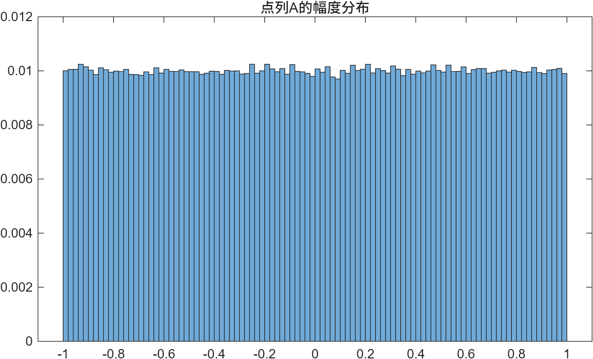
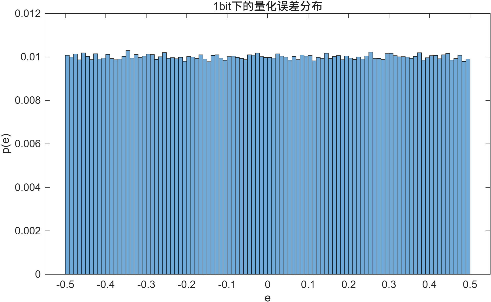
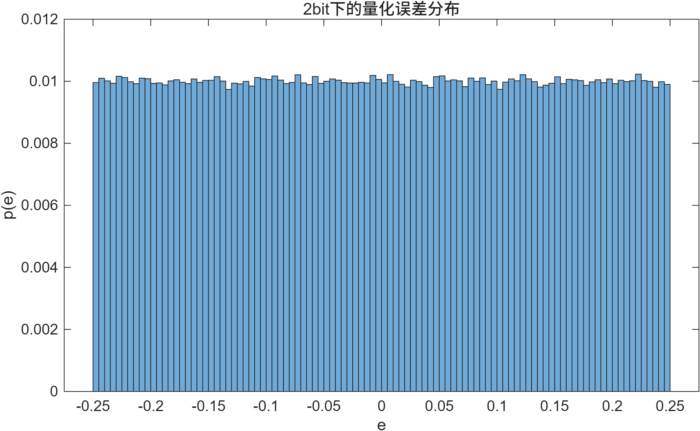
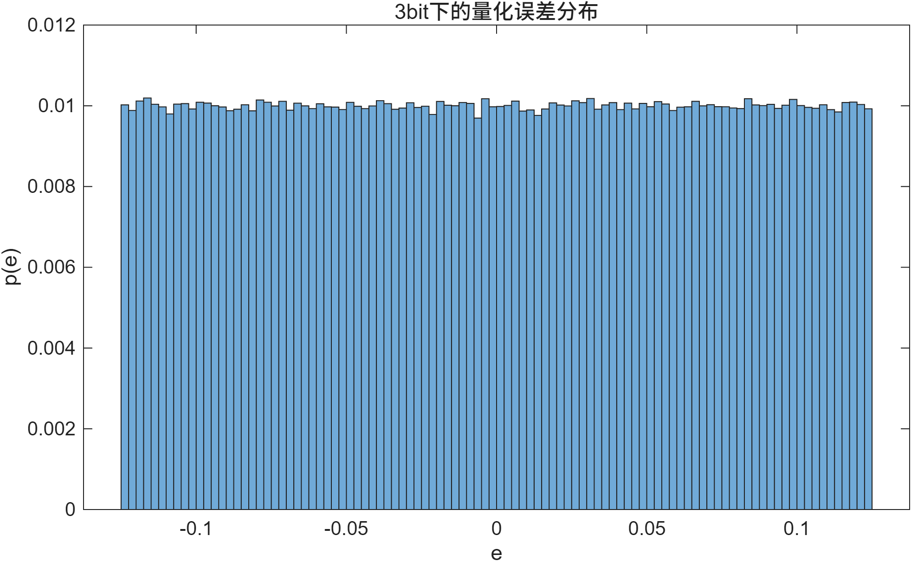
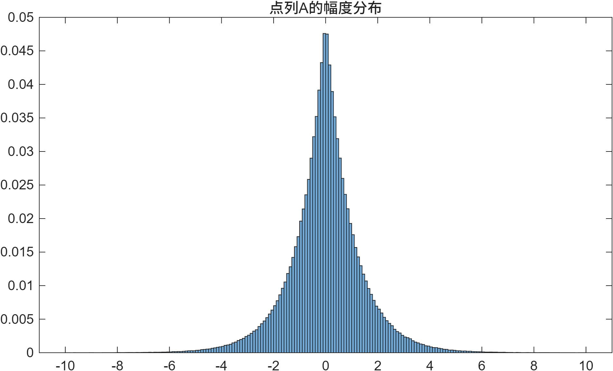
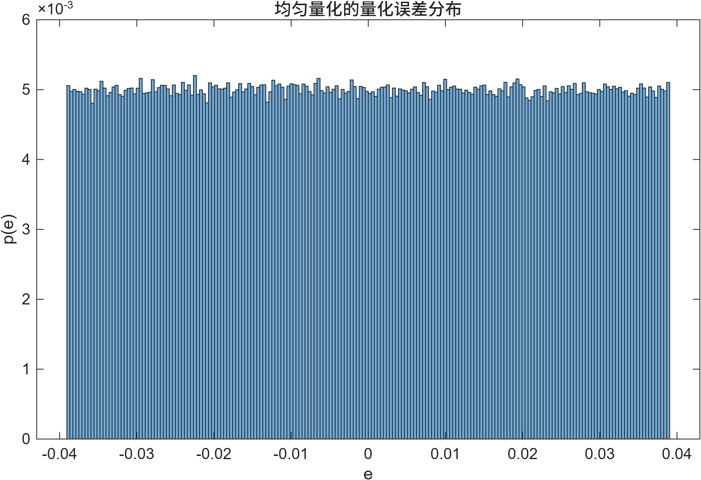
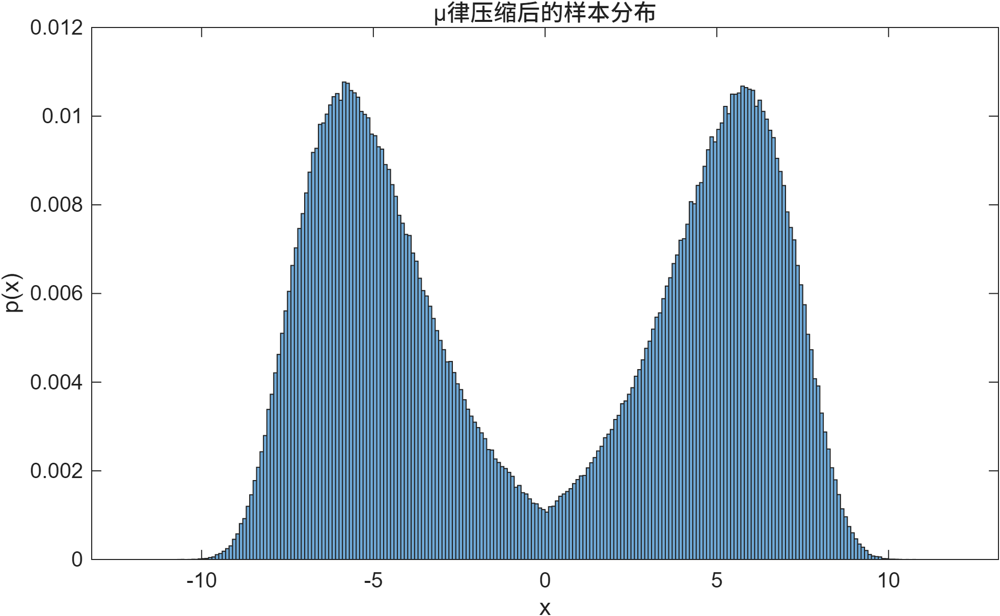
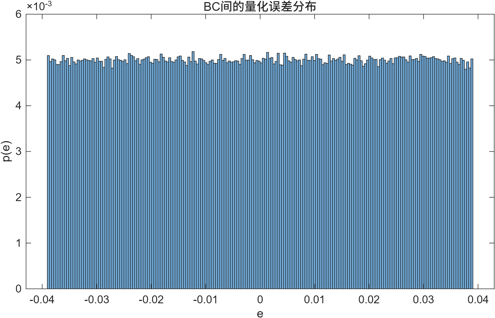
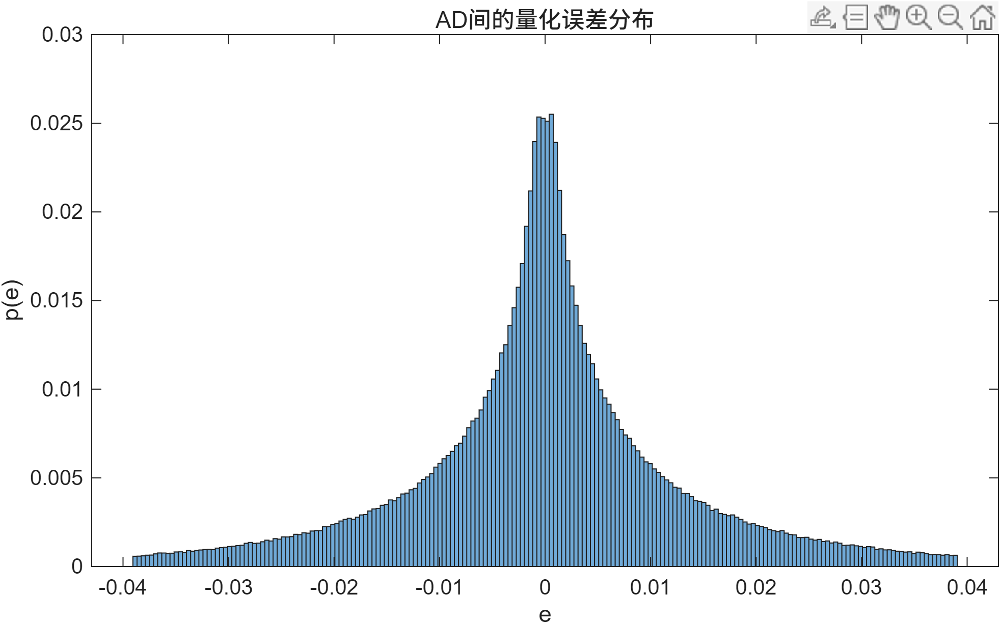

# 1. 实验目的

1. 通过 MATLAB 仿真熟悉压缩量化方案的实现及性能指标测量方法。
2. 通过均匀分布信源的均匀量化，理解量化间隔、量化误差、量化噪声功率和信噪比之间的关系。
3. 通过拉普拉斯分布信源的均匀量化与基于 $\mu$ 律压扩的非均匀量化，比较两类量化器的性能和适用场景。
4. 对实验值与理论值进行对照，分析有限样本、直方图分箱、过载失真和近似公式等因素造成的差异。

# 2. 实验内容

## 2.1 均匀分布下的均匀量化

生成均匀分布随机样本，分别进行 1-bit、2-bit 和 3-bit 均匀量化；观察信源及量化误差的分布，计算信号功率、量化噪声功率和信噪比，并将实验结果与理论值进行比较。

## 2.2 基于 $\mu$ 律压扩的非均匀量化

生成拉普拉斯分布随机样本，分别采用 8-bit 均匀量化和基于 $\mu$ 律压扩的非均匀量化；观察压缩前后的样本分布及各阶段量化误差，计算噪声功率和信噪比，并比较两种量化方式的性能。

# 3. 实验环境

- MATLAB 版本：R2025b
- 操作系统：Windows 11

# 4. 实验原理

## 4.1 量化器设计的统计基础

标量量化用有限个重建电平表示连续取值。设分层电平为
$t_0<t_1<\cdots<t_L$，第 $k$ 个量化区间为
$\mathcal I_k=[t_k,t_{k+1})$，对应的重建电平为 $y_k$，则量化器可写为

$$
Q(x)=y_k,\qquad x\in\mathcal I_k.
$$

若以均方误差为失真准则，量化器的设计目标是使

$$
D=E\!\left[(X-Q(X))^2\right]
$$

尽可能小。信源的概率密度决定了不同幅度区间对总失真的贡献，因此量化级应与样本在各幅度处出现的频率相匹配。

本实验中的两类信源体现了两种典型情形。对于 $[-1,1]$ 上的均匀分布，等间隔分配量化级与其统计特性相匹配；拉普拉斯分布则在零点附近高度集中并具有长尾。若仍直接等间隔量化，许多量化级会分配给出现概率很小的大幅度区域，而零点附近的高概率样本只能共用相对稀疏的量化级，因而不是一种高效的级数分配方式。

## 4.2 分层电平与重建电平的选取

对一般信源，在均方误差准则下，最优标量量化器应满足两个基本条件。给定重建电平时，分层电平应位于相邻重建电平的中点：

$$
t_k=\frac{y_{k-1}+y_k}{2},\qquad k=1,2,\ldots,L-1.
$$

给定量化区间时，重建电平应取该区间内输入的条件均值：

$$
y_k=E[X\mid X\in\mathcal I_k].
$$

前一条件保证每个输入被映射到误差较小的相邻电平，后一条件保证该区间内的平均平方误差最小。

对于量化范围 $[-x_{\max},x_{\max}]$ 内的均匀分布，相应的分层电平和重建电平可选为

$$
t_k=-x_{\max}+k\Delta,\quad k=0,1,\ldots,L,
$$

$$
y_k=\frac{t_k+t_{k+1}}{2}
=-x_{\max}+\left(k+\frac12\right)\Delta,
\quad k=0,1,\ldots,L-1.
$$

采用区间中点作为重建值，既符合条件均值原则，又使区间内的最大误差限制为 $\Delta/2$。对于超出量化范围的输入，量化器只能输出最外侧的重建电平，这种饱和会产生过载误差。

## 4.3 $\mu$ 律压扩及其对输入鲁棒性

$\mu$ 律压扩通过“先压缩、再均匀量化、最后扩张”实现非均匀量化。压缩函数及逆映射分别为

$$
g(x)=x_{\max}\frac{\ln\left(1+\mu|x|/x_{\max}\right)}{\ln(1+\mu)}
\operatorname{sgn}(x),
$$

$$
g^{-1}(y)=\operatorname{sgn}(y)\frac{x_{\max}}{\mu}
\left[(1+\mu)^{|y|/x_{\max}}-1\right].
$$

其斜率为

$$
g'(x)=\frac{\mu}{\ln(1+\mu)\left(1+\mu|x|/x_{\max}\right)}.
$$

$\mu$ 律先把小幅度信号拉伸、把大幅度信号压缩，再进行均匀量化。在零点附近，$g'(x)$ 较大，压缩域中的等间隔量化级映射回原信号域后非常密集；随着 $|x|$ 增大，$g'(x)$ 逐渐减小，原信号域中的量化级间隔也随之变宽。因此，小信号用较小的步长精细量化，大信号用较大的步长粗略量化。

若压缩域均匀量化步长为 $\Delta_y=2x_{\max}/L$，则原信号域在幅度 $x$ 附近的等效量化步长近似为

$$
\Delta_x(x)\approx\frac{\Delta_y}{g'(x)}
=\frac{2\ln(1+\mu)}{L}
\left(|x|+\frac{x_{\max}}{\mu}\right).
$$

因此，$\mu$ 律的“对输入鲁棒”可以直接理解为：**输入幅度虽然会变化，但相对量化误差近似不变，因而量化信噪比对输入强弱不敏感。** 当 $|x|\gg x_{\max}/\mu$ 时，$\Delta_x(x)/|x|$ 近似为常数；在 $\mu\gg1$、量化分辨率较高且没有明显过载的条件下，信噪比主要由量化级数 $L$ 和参数 $\mu$ 决定，而较少依赖输入功率及其具体分布。这也使 $\mu$ 律适合拉普拉斯一类小幅度样本多、动态范围大的信源。

# 5. 实验内容

## 5.1 均匀分布下的均匀量化

### 5.1.1 实验步骤

1. **生成样本。** 设置随机种子为 2026，在 $[-1,1]$ 上生成 $N=10^6$ 个均匀分布随机样本，组成点列 $A$。
2. **观察信源分布。** 绘制点列 $A$ 的幅度直方图，与理论概率密度 $p_X(x)=0.5$ 比较，分析差异及其影响因素。
3. **设置量化器。** 依次取量化位数 $R=1,2,3$，计算量化级数 $L=2^R$、量化间隔 $\Delta=2/L$、量化区间和重建电平。
4. **完成均匀量化。** 将点列 $A$ 中的每个样本映射到对应重建电平，得到重建点列 $\hat A$；计算量化误差 $e=A-\hat A$，并绘制三种量化位数下的误差分布。
5. **计算性能指标。** 分别计算实验信号功率 $\sigma_{s,\mathrm{exp}}^2$、量化噪声功率 $\sigma_{q,\mathrm{exp}}^2$ 和量化信噪比 $\mathrm{SNR}_{q,\mathrm{exp}}$；根据理论公式计算对应理论值，并统一换算为 $dB$。
6. **记录并分析结果。** 比较实验值与理论值的差异，分析量化位数对误差范围、噪声功率和信噪比的影响。

### 5.1.2 需自行推导的内容

本实验的信源在 $[-1,1]$ 上服从均匀分布，其概率密度为

$$
p_X(x)=
\begin{cases}
\dfrac{1}{2}, & -1\leq x\leq 1,\\[4pt]
0, & \text{其他}.
\end{cases}
$$

理论信号功率为

$$
\begin{aligned}
\sigma_{s,\mathrm{th}}^2
&=E[X^2]
=\frac{1}{3}.
\end{aligned}
$$

换算为 dB 得

$$
\sigma_{s,\mathrm{th,dB}}^2
=-4.7712\ \mathrm{dB}.
$$

采用 $R$ bit 均匀量化时，量化级数为 $L=2^R$，量化间隔为

$$
\Delta=\frac{2}{L}=\frac{2}{2^R}=2^{1-R}.
$$

量化范围与信源范围一致，不产生过载噪声。采用区间中点作为重建电平时，误差在 $[-\Delta/2,\Delta/2]$ 内均匀分布，故

$$
\sigma_{q,\mathrm{th}}^2
=E[e^2]=\frac{\Delta^2}{12}.
$$

所以理论量化信噪比为

$$
\begin{aligned}
\mathrm{SNR}_{q,\mathrm{th}}
&=\frac{\sigma_{s,\mathrm{th}}^2}{\sigma_{q,\mathrm{th}}^2}
=\frac{4}{\Delta^2}
=2^{2R}.
\end{aligned}
$$

换算为 dB：

$$
\begin{aligned}
\mathrm{SNR}_{q,\mathrm{th,dB}}
&=10\log_{10}\left(2^{2R}\right)\\
&=20R\log_{10}2
\approx6.0206R\ \mathrm{dB}.
\end{aligned}
$$

分别代入 $R=1,2,3$，得到理论结果：

| $R$ | $\Delta$ | $\sigma_{q,\mathrm{th}}^2/dB$ | $\sigma_{s,\mathrm{th}}^2/dB$ | $\mathrm{SNR}_{q,\mathrm{th}}/dB$ |
|:---:|:---:|:---:|:---:|:---:|
| 1 | 1 | -10.7918 | -4.7712 | 6.0206 |
| 2 | 0.5 | -16.8124 | -4.7712 | 12.0412 |
| 3 | 0.25 | -22.8330 | -4.7712 | 18.0618 |

: $R-bit$ 均匀量化下的理论值

### 5.1.3 各填充部分功能的实现代码

- 均匀分布直方图格点的选取

```matlab
% 画出幅度分布
bins = -1:0.02:1; %选取合理的直方图格点数
histogram(s, bins,'Normalization','probability');
title("点列A的幅度分布");
```

- 均匀分布分层电平与重建电平的选取

```matlab
L = 2^B; %量化区间
interval = 2*V/L; %量化间隔
x = -V:interval:V; %分层电平[x_1,x_2,..,x_{L+1}]
y = (x(1:end-1)+x(2:end))/2; %重建电平[y_1,y_2,...,y_L]
```

- 均匀量化过程

```matlab
%% 实验计算
for i = 1:N  %循环点列
    for j = 1:L  %循环区间
         % 完成均匀量化，得到量化后的采样s_hat
        if (x(j)<=s(i))&&(s(i)<x(j+1))
            s_hat(i)=y(j);
            break;
        end
     end
end
```

- 重建误差直方图格点的选取

```matlab
exbins=-interval/2:interval/100:interval/2; %选取合理的直方图格点数
histogram(ex,exbins,'Normalization','probability'); %计算e(x)的分布
title(num2str(B)+"bit下的量化误差分布")
```

### 5.1.4 理论计算方法和数值计算代码

- 理论噪声与信号功率的计算

```matlab
%% 理论计算
noise_th = interval.^2/12; %量化噪声方差
power_th = V.^2/3; %信号功率
snr_th = power_th/noise_th;
snrdb_th = 10*log10(snr_th);
```

- 仿真噪声与信号功率的计算

```matlab
ex = s-s_hat;  %量化误差e(x)
power_exp = mean(s.^2);  %信号功率
noise_exp = mean(ex.^2); %量化噪声方差
snr_exp = power_exp/noise_exp;  %量化信噪比
snrdb_exp = 10*log10(snr_exp);
```

### 5.1.5 实验数据记录及曲线

{width=66%}

{width=66%}

{width=66%}

{width=66%}

| 指标 $/dB$ | $1-bit$ | $2-bit$ | $3-bit$ |
|:---:|---:|---:|---:|
| $\sigma_{q,\mathrm{exp}}^2$ | -10.7902 | -16.8123 | -22.8316 |
| $\sigma_{q,\mathrm{th}}^2$ | -10.7918 | -16.8124 | -22.8330 |
| $\sigma_{s,\mathrm{exp}}^2$ | -4.7689 | -4.7689 | -4.7689 |
| $\sigma_{s,\mathrm{th}}^2$ | -4.7712 | -4.7712 | -4.7712 |
| $\mathrm{SNR}_{q,\mathrm{exp}}$ | 6.0213 | 12.0434 | 18.0629 |
| $\mathrm{SNR}_{q,\mathrm{th}}$ | 6.0206 | 12.0412 | 18.0618 |

: 均匀量化性能指标实验值与理论值的对比

### 5.1.6 结果分析

点列 $A$ 的幅度直方图在 $[-1,1]$ 内基本平坦，与均匀分布的理论特征一致。少量起伏来自有限样本的随机统计误差。

三种量化位数下的误差均近似分布在 $[-\Delta/2,\Delta/2]$ 内。量化位数每增加 1 bit，量化间隔和误差范围减半，量化噪声功率约下降 6.02 dB，信噪比约提高 6.02 dB。表 1 中实验值与理论值十分接近，微小差异主要由有限样本和浮点运算误差造成，说明均匀量化的实验结果与理论分析一致。

## 5.2 基于 $\mu$ 律压扩的非均匀量化

### 5.2.1 实验步骤

1. **生成样本。** 设置随机种子为 2026，取 $\sigma_x=\sqrt{2}$，利用逆累积分布法生成 $N=10^6$ 个拉普拉斯分布随机样本，组成点列 $A$；绘制幅度直方图并验证其分布特征。
2. **进行直接均匀量化。** 在 $[-10,10]$ 内采用 8 bit 均匀量化器对点列 $A$ 进行量化，对范围外样本作饱和处理，得到重建点列 $\hat A$；计算并绘制误差 $e_A=A-\hat A$ 的分布。
3. **统计均匀量化结果。** 计算点列 $A$ 的信号功率 $E[X_{\mathrm{exp}}^2]$、总量化噪声功率 $\sigma_{\mathrm{exp}}^2$ 和信噪比 $\mathrm{SNR}_{\mathrm{exp}}$。
4. **进行 $\mu$ 律压缩。** 取 $x_{\max}=10$、$\mu=255$，利用压缩函数 $g(x)$ 将点列 $A$ 变换为点列 $B$；绘制点列 $B$ 的幅度分布，并与点列 $A$ 比较。
5. **量化压缩信号。** 在 $[-10,10]$ 内对点列 $B$ 进行 8 bit 均匀量化，得到点列 $C$；计算并绘制误差 $e_{BC}=B-C$ 的分布，统计 $E[X_B^2]_{\mathrm{exp}}$、$\sigma_{BC,\mathrm{exp}}^2$ 和 $\mathrm{SNR}_{BC,\mathrm{exp}}$。
6. **进行 $\mu$ 律扩张。** 利用逆映射 $g^{-1}(x)$ 将点列 $C$ 扩张为重建点列 $D$；计算并绘制总误差 $e_{AD}=A-D$ 的分布，统计 $E[X^2]_{\mathrm{exp}}$、$\sigma_{AD,\mathrm{exp}}^2$ 和 $\mathrm{SNR}_{AD,\mathrm{exp}}$。
7. **比较并分析结果。** 计算理论信噪比 $\mathrm{SNR}_{q,AD,\mathrm{th}}$，比较理论值与实验值，并将 $\mu$ 律非均匀量化结果与步骤 2、3 的直接均匀量化结果进行比较，分析性能差异及原因。

### 5.2.2 需自行推导的内容

本实验的拉普拉斯信源满足

$$
p_X(x)=\frac{1}{2}e^{-|x|}.
$$

概率密度关于原点对称，理论信号功率为

$$
\begin{aligned}
E[X^2]
&=\int_{-\infty}^{\infty}x^2\frac{1}{2}e^{-|x|}\,\mathrm{d}x
=2.
\end{aligned}
$$

换算为 dB：

$$
E[X^2]_{\mathrm{dB}}=3.0103\ \mathrm{dB}.
$$

压缩函数的导数为

$$
g'(A)=
\frac{\mu}{\ln(1+\mu)\left(1+\mu|A|/x_{\max}\right)}.
$$

在高分辨率量化、$\mu\gg1$ 且忽略过载噪声的条件下，压缩域均匀量化误差经逆映射后，原信号域的理论量化噪声功率近似为

$$
\begin{aligned}
\sigma_{q,\mathrm{th}}^2
\approx\frac{\ln^2(1+\mu)}{3L^2}E[A^2].
\end{aligned}
$$

所以理论量化信噪比为

$$
\begin{aligned}
\mathrm{SNR}_{q,AD,\mathrm{th}}
&=\frac{E[A^2]}{\sigma_q^2}
&\approx\frac{3L^2}{\ln^2(1+\mu)}.
\end{aligned}
$$

代入 $L=2^8=256$、$\mu=255$，得到

$$
\begin{aligned}
\mathrm{SNR}_{q,AD,\mathrm{th,dB}}
&=10\log_{10}\left[\frac{3\times256^2}{\ln^2(256)}\right]\\
&=38.0577\ \mathrm{dB}.
\end{aligned}
$$

### 5.2.3 各填充部分功能的实现代码

- 拉普拉斯分布直方图格点的选取

```matlab
bins = -V_max:V_max/100:V_max; %选取合理的直方图格点数
```

- 均匀量化噪声直方图格点的选取

```matlab
nbins = -0.5*interval:interval/200:0.5*interval; % 选取合理的直方图格点数
```

- $\mu$ 律压缩后分布直方图格点的选取

```matlab
nbins_B=-1.2*V_max:V_max/100:1.2*V_max; % 选取合理的直方图格点数
```

- 中间均匀量化步骤噪声直方图格点的选取

```matlab
nbins_ex1=nbins; % 选取合理的直方图格点数
%% nbins = -0.5*interval:interval/200:0.5*interval;
```

- 最终总量化误差直方图格点的选取

```matlab
nbins_ex2=nbins; % 选取合理的直方图格点数
%% nbins = -0.5*interval:interval/200:0.5*interval;
```

- 均匀量化分层电平与重建电平的选取

```matlab
%% A均匀量化，注意对信号截断到[-10,10]区间内
A_hat = zeros(size(A));
L = 2^8; %量化区间
interval = 2*V_max/L; %量化间隔
x = -V_max:interval:V_max; %分层电平
y = (x(1:end-1)+x(2:end))/2; %重建电平
```

- 均匀量化

```matlab
for i = 1:N  %循环点列
    for j = 1:L  %循环区间
        % 完成均匀量化，得到量化后的采样A_hat
        if A(i)<=x(1)
            A_hat(i)=y(1);
            break;
        elseif A(i)>=x(end)
            A_hat(i)=y(end);
            break;
        elseif (x(j)<=A(i))&&(A(i)<x(j+1))
            A_hat(i)=y(j);
            break;
        end
    end
end
```

- $\mu$ 律压缩表达式

```matlab
%% mu律压缩
B = sign(A).*V_max.*log(1+mu.*abs(A)./V_max)./log(1+mu);
```

- $\mu$ 律压缩后，分层电平与重建电平的选取

```matlab
%% BC均匀量化，注意对信号截断到[-10,10]区间内
C = zeros(size(B));
L = 2^8; %量化区间
interval = 2*V_max/L; %量化间隔
x = -V_max:interval:V_max; %分层电平
y = (x(1:end-1)+x(2:end))/2; %重建电平
```

- $\mu$ 律压缩后，进行均匀量化

```matlab
for i = 1:N  %循环点列
    for j = 1:L  %循环区间
        % 完成均匀量化，得到量化后的采样C
        if B(i)<=x(1)
            C(i)=y(1);
            break;
        elseif B(i)>=x(end)
            C(i)=y(end);
            break;
        elseif (x(j)<=B(i))&&(B(i)<x(j+1))
            C(i)=y(j);
            break;
        end
    end
end
```

- $\mu$ 律扩张表达式

```matlab
%% mu律扩张
D=sign(C).*V_max./mu.*((1+mu).^(abs(C)/V_max)-1);
```

### 5.2.4 理论计算方法和数值计算代码

- 直接均匀量化

```matlab
ex=A-A_hat; %均匀量化的量化误差e(x)
power_exp = mean(A.^2);  %信号功率
noise_exp = mean(ex.^2); %噪声方差
snr_exp = power_exp/noise_exp;
snrdb_exp = 10*log10(snr_exp);
```

- 中间均匀量化步骤

```matlab
ex1=B-C; %BC间的量化误差e(x)
powerBC_exp = mean(B.^2);  %信号功率
noiseBC_exp = mean(ex1.^2); %噪声方差
snrBC_exp = powerBC_exp/noiseBC_exp;
snrBCdb_exp = 10*log10(snrBC_exp);
```

- 总量化噪声

```matlab
ex2=A-D; %AD间的量化误差e(x)
powerAD_exp = mean(A.^2);  %信号功率
noiseAD_exp = mean(ex2.^2); %噪声方差
snrAD_exp = powerAD_exp/noiseAD_exp;
snrADdb_exp = 10*log10(snrAD_exp);
```

### 5.2.5 实验数据记录及曲线

{width=66%}

{width=66%}

| $E[X_A^2]_{\mathrm{exp}}/dB$ | $\sigma_{\mathrm{exp}}^2/dB$ | $\mathrm{SNR}_{\mathrm{exp}}/dB$ |
|:---:|:---:|:---:|
| 3.0228 | -31.9044 | 34.9244 |

: 拉普拉斯信源直接均匀量化性能指标

{width=66%}

{width=66%}

| $E[X_B^2]_{\mathrm{exp}}/dB$ | $\sigma_{BC,\mathrm{exp}}^2/dB$ | $\mathrm{SNR}_{BC,\mathrm{exp}}/dB$ |
|:---:|:---:|:---:|
| 14.6622 | -32.9073 | 47.5665 |

: $BC$ 间均匀量化性能指标

{width=66%}

| $E[X_A^2]_{\mathrm{exp}}/dB$ | $\sigma_{AD,\mathrm{exp}}^2/dB$ | $\mathrm{SNR}_{AD,\mathrm{exp}}/dB$ | $\mathrm{SNR}_{q,\mathrm{th}}/dB$ |
|:---:|:---:|:---:|:---:|
| 3.0228 | -33.1426 | 36.1683 | 38.0577 |

: $\mu$ 律压扩量化性能指标实验值与理论值的对比

### 5.2.6 结果分析

点列 $A$ 的幅度分布关于原点对称，大量样本集中在零点附近，并随幅度增大而迅速减少，具有拉普拉斯分布典型的尖峰和长尾特征。样本几乎全部位于 $[-10,10]$ 内。均匀量化时，零点附近的大量样本只能获得与低概率大幅样本相同的分辨率；极少量越界样本还会因饱和而产生较大的过载误差。

经过 $\mu$ 律压缩后，零点附近的小幅样本被拉开，而大幅样本被压缩，压缩域中的样本分布比原信号更加分散。随后在压缩域进行均匀量化，相当于在原信号域的零点附近布置较密的量化级、在大幅度区域布置较疏的量化级。

将 $C$ 逆变换为重建信号 $D$ 后，压缩域中大小近似一致的量化误差会被扩张成不同大小的原信号域误差：小幅样本对应较小误差，大幅样本对应较大误差。因此，$A-D$ 的误差分布在零点附近较集中，同时具有一定尾部。最终总噪声功率为 -33.1426 dB，信噪比为 36.1683 dB。与直接均匀量化相比，噪声功率降低约 1.24 dB，信噪比提高约 1.24 dB，说明 $\mu$ 律能更合理地利用有限量化级，对该拉普拉斯信源具有更好的总体量化性能。

关于实验值与理论值的差异，首先，理论值采用了高分辨率近似。设压缩域量化误差为 $e_y$，则将逆映射在量化点附近线性化，有

$$
e_x\approx\frac{e_y}{g'(x)},
\qquad E[e_y^2]\approx\frac{\Delta_y^2}{12}.
$$

由此得到原信号域的量化噪声功率

$$
\begin{aligned}
\sigma_q^2
&\approx \frac{\ln^2(1+\mu)}{3L^2}
E\!\left[\left(|X|+\frac{x_{\max}}{\mu}\right)^2\right]\\
&=\frac{\ln^2(1+\mu)}{3L^2}
\left(E[X^2]+\frac{2x_{\max}}{\mu}E[|X|]
+\frac{x_{\max}^2}{\mu^2}\right).
\end{aligned}
$$

进一步利用 $\mu\gg1$，忽略含 $1/\mu$ 和 $1/\mu^2$ 的两项，才得到第 5.2.2 节使用的理论近似

$$
\sigma_{q,\mathrm{th}}^2
\approx\frac{\ln^2(1+\mu)}{3L^2}E[X^2],
\qquad
\mathrm{SNR}_{q,\mathrm{th}}
\approx\frac{3L^2}{\ln^2(1+\mu)}.
$$

被忽略的两项均为正值，并且在 $|X|$ 较小时，$1/\mu$ 和 $1/\mu^2$ 反而占主导。因此该近似会低估实际量化噪声，并使理论信噪比偏高。


此外，上述推导还假设压缩域误差可近似为均匀分布、逆映射在一个量化区间内可用直线代替，并且输入不会超出量化范围。

实验计算使用的是全部样本的实际端到端误差

$$
\sigma_{AD,\mathrm{exp}}^2
=\frac{1}{N}\sum_{i=1}^{N}
\left[A_i-g^{-1}\!\left(Q(g(A_i))\right)\right]^2.
$$

其中不仅包含量化范围内的颗粒误差，还包含拉普拉斯长尾样本越界后产生的过载误差。外侧样本被限制到端点重建电平后，其误差可能远大于普通量化误差；即使数量很少，也会因平方运算而对总噪声产生明显影响。逆映射的非线性、端点饱和以及有限样本的统计波动也会带来附加偏差。因此，实验信噪比 36.1683 dB 比理论值 38.0577 dB 低约 1.89 dB 是合理的：理论值反映理想近似下的范围内量化性能，而实验值反映包含各种实际误差的总体性能。

# 6. 实验总结、体会和建议

## 6.1 实验总结

本实验研究了均匀量化和 $\mu$ 律压扩量化。对于均匀信源，量化位数每增加 1 bit，量化间隔减半，量化噪声功率约下降 6.02 dB，信噪比约提高 6.02 dB，实验结果与理论值一致。

对于零点附近样本密集的拉普拉斯信源，$\mu$ 律通过在小幅度区域分配更密的量化级改善了量化性能。实验信噪比由直接均匀量化的 34.9244 dB 提高到 36.1683 dB，提升约 1.24 dB，说明量化级的分配应与信源统计特性相匹配。

## 6.2 实验体会

通过本实验，进一步理解了分层电平、重建电平和量化误差之间的关系。程序实现时需要统一边界判决规则，并正确处理超出量化范围的样本。

理论公式通常建立在高分辨率、误差近似均匀和忽略过载等条件下，而仿真还包含有限样本波动、端点饱和和过载误差。因此，应结合理论假设分析实验值与理论值之间的偏差，并注意功率与信噪比均使用 $10\log_{10}(\cdot)$ 换算为 dB。

## 6.3 改进建议

可将逐样本的双重循环改为向量化量化，以提高仿真效率；在直方图中叠加理论概率密度曲线，使分布比较更加直观。此外，可分别统计颗粒噪声和过载噪声，并改变 $x_{\max}$ 与 $\mu$，进一步研究动态范围、过载概率和小信号分辨率之间的折中。